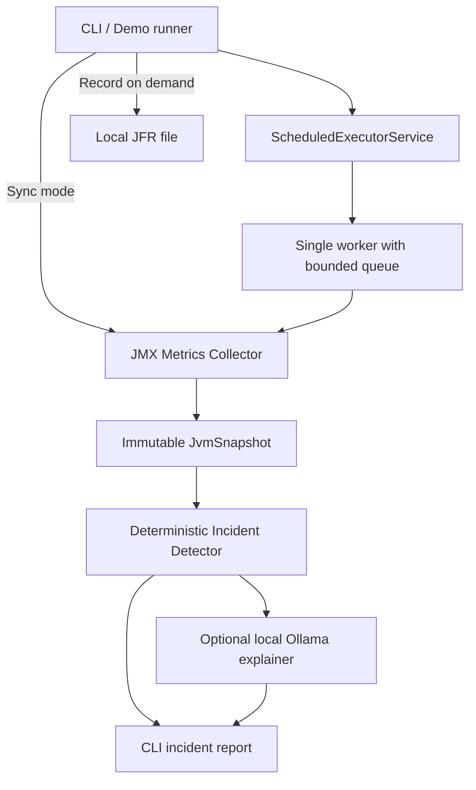

# JVM Sentinel AI — Architecture

## Runtime architecture

| Module | Responsibility |
|---|---|
| sentinel-core | Scheduled sampling, bounded work queue, JMX collection, and immutable snapshots |
| sentinel-detector | Deterministic deadlock, heap, and executor saturation rules and incident evidence |
| sentinel-ai | Optional localhost Ollama generate API; analysis only |
| sentinel-cli | Terminal output and controlled deadlock, executor, and CPU workloads |

The CLI currently monitors its **own** JVM. A deadlock demonstration launches two daemon
platform threads that deadlock intentionally. They do not prevent process exit.

## Sampling and backpressure

In async mode, explicit start schedules an immediate collection job and then one job
per tick. The CLI allows four waiting jobs and one active job. The worker collects
a fresh snapshot and completes reporting before starting the next job. A zero
interval uses 1 ms in async mode. Synchronous mode collects and reports on the
calling thread.

A full queue drops the incoming tick. The next tick retries submission, so drops
do not consume the iteration budget. Accepted counts collection jobs. Collected
and processed count successful snapshots and handler calls, respectively. A
recoverable collector or handler exception is logged, counted separately, and
consumes the accepted attempt. Later attempts continue. Queue depth is a live gauge.

The pipeline starts once. Starting twice or after close throws
`IllegalStateException`. The first close stops submissions and gives accepted
jobs five seconds to drain. A timeout or interruption cancels the run, discards
queued jobs, and interrupts the active worker. Subsequent close calls return.

## Thread and JFR evidence

The collector keeps all IDs returned by the deadlock check and requests stack
details for at most eight of those platform threads, ordered by ID. Each detail
includes the thread state, lock and owner when present, and at most 12 stack
frames. A thread that disappears before lookup can have an ID without details.
The detector attaches the details to the deadlock incident. The CLI renders them
locally, and the Ollama prompt continues to use the existing rule evidence.

JFR records the current JVM only when enabled. It records for the selected
window, caps retained recording data at 16 MiB by JFR chunk, and saves the dump
to a unique file once the sampling workload and recording window finish. Enabled
events are `jdk.ThreadSleep`, `jdk.JavaMonitorEnter` (10 ms threshold), and
`jdk.GarbageCollection`. When supported, it also enables `jdk.CPULoad` at a
one-second period and `jdk.ExecutionSample` at a 20 ms period. The optional
summary streams the finished file, reports zero counts, and reports a parsing
error if the file exceeds 64 MiB or one million events. The recording closes
on success, interruption, or error.

## Workload evidence

The executor demo uses two named workers and a four-slot bounded queue. It uses
latches to hold both workers while the queue fills. A separate immutable snapshot
captures the executor counters before releasing the workers. The detector uses
worker and queue capacity independently of the rejection counter. Cleanup
releases the latch, drains accepted tasks, and bounds both graceful and forced waits.

The CPU demo uses one interruptible arithmetic worker for 1–5 seconds. Worker
CPU time comes from the JVM thread MXBean when enabled. The CPU demo emits no
pressure incident from this single measurement. For both new workloads, a JFR
recording starts before the demo and has a scheduled stop deadline. If the
workload misses that deadline, no purported full-workload artifact is saved.
JFR counts are observations for the recorded JVM and do not establish causation.

## Limits of the starter
- No remote JVM attachment or distributed agent.
- JMX ThreadMXBean deadlock APIs inspect platform threads; do not promise virtual-thread detection.
- High heap occupancy alone is not proof of a memory leak.
- AI output is advisory and limited to the evidence passed into the prompt.
- This is an educational MVP, not production observability infrastructure.
