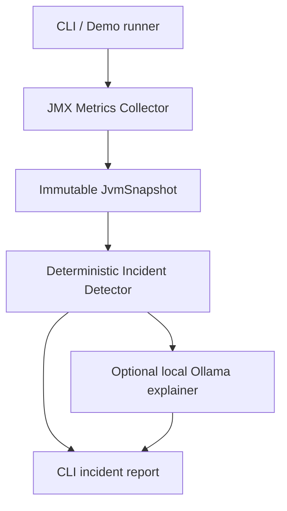

# JVM Sentinel AI — Architecture

## Current MVP

| Module | Responsibility |
|---|---|
| sentinel-core | JMX collection and immutable Java records |
| sentinel-detector | Deterministic deadlock/heap rules and incident evidence |
| sentinel-ai | Optional localhost Ollama generate API; analysis only |
| sentinel-cli | Terminal output and controlled deadlock simulation |

The CLI currently monitors its **own** JVM. A deadlock demonstration launches two daemon
platform threads that deadlock intentionally. They do not prevent process exit.

## Next milestones
1. Bounded async sampling pipeline and tests: ThreadPoolExecutor, BlockingQueue, safe shutdown.
2. Configurable sampling intervals and JSONL persistence using NIO.
3. Thread dump collection on detected deadlocks and JFR event consumption.
4. Correlation rules and benchmark simulations with explicit measured baselines.
5. REST API/dashboard, if needed, after the monitoring engine is solid.

## Limits of the starter
- No remote JVM attachment or distributed agent.
- JMX ThreadMXBean deadlock APIs inspect platform threads; do not promise virtual-thread detection.
- High heap occupancy alone is not proof of a memory leak.
- AI output is advisory and limited to the evidence passed into the prompt.
- This is an educational MVP, not production observability infrastructure.
